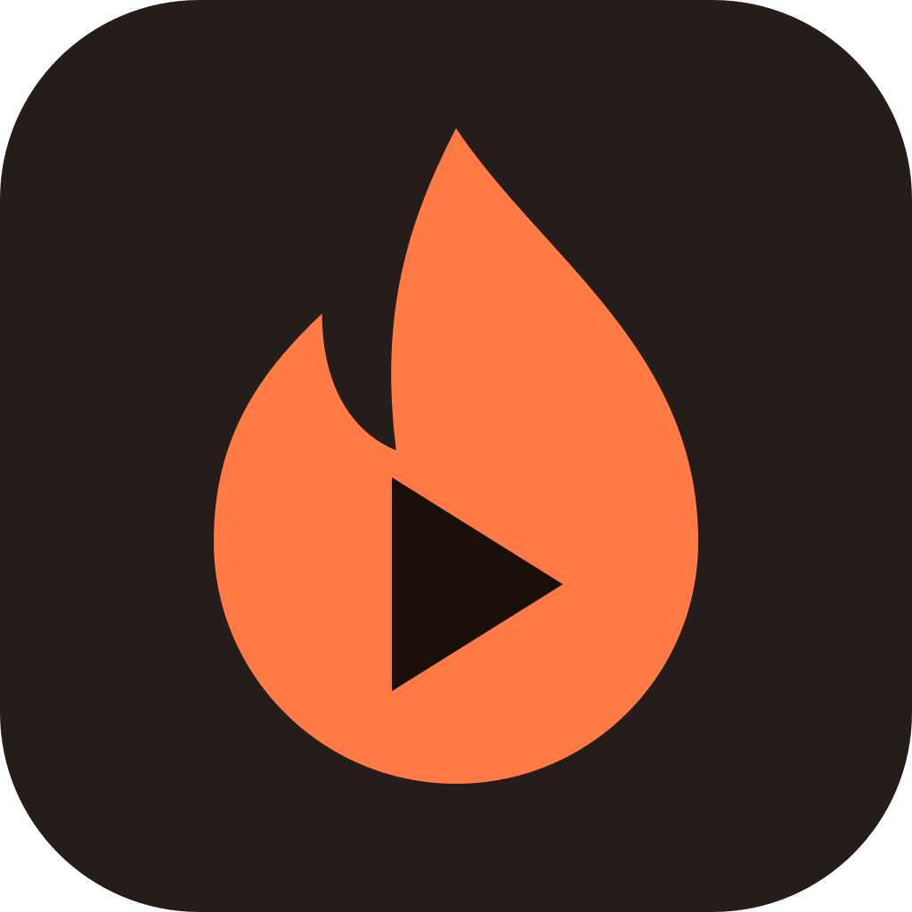
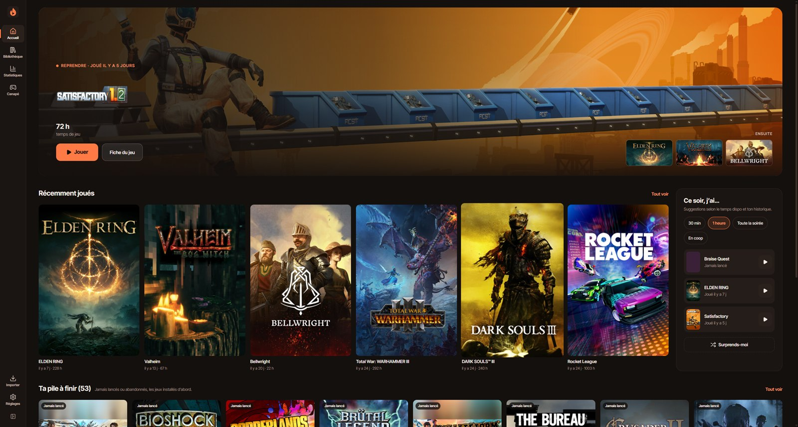
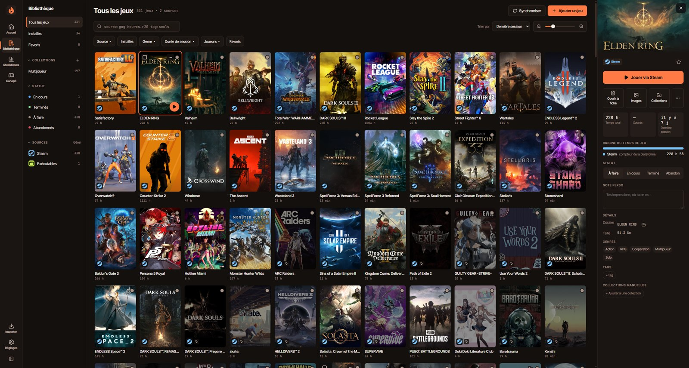
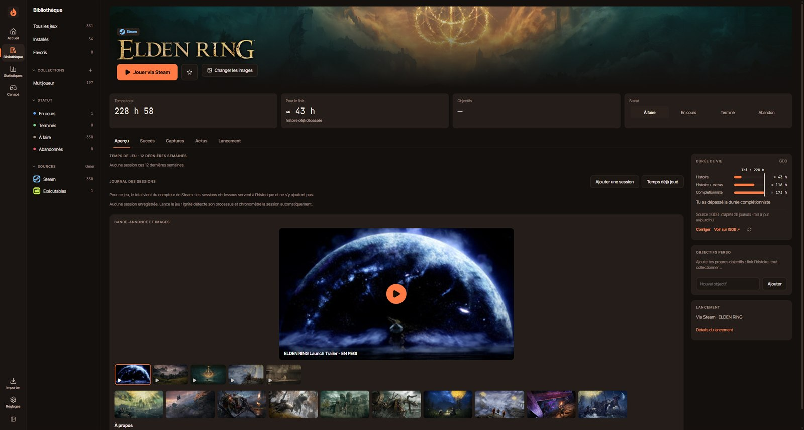
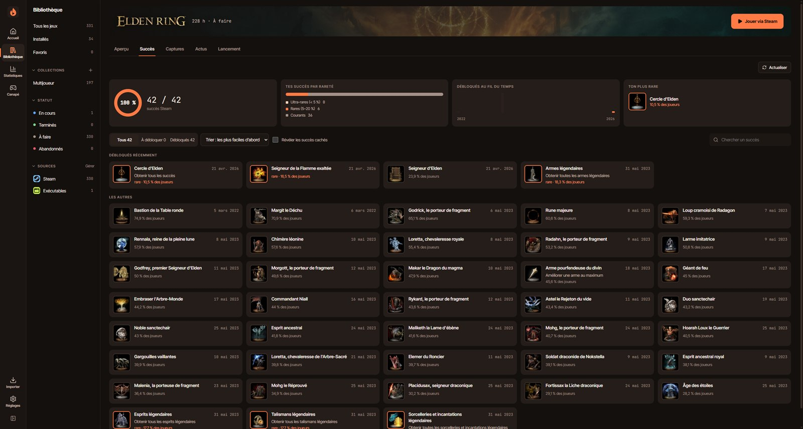
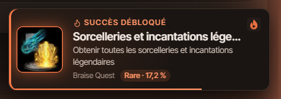
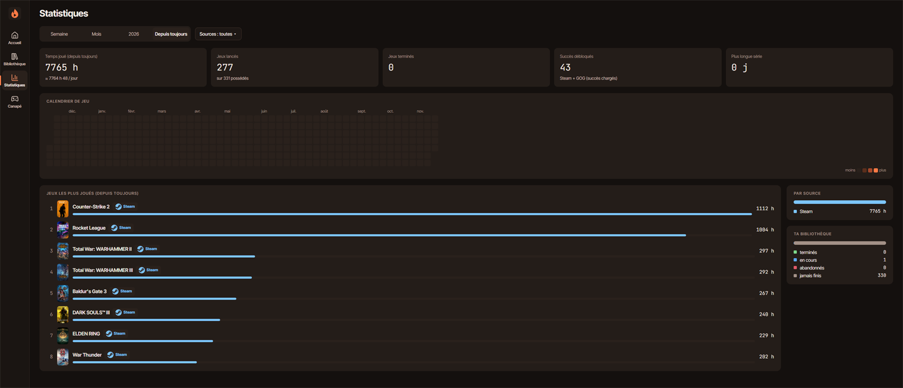
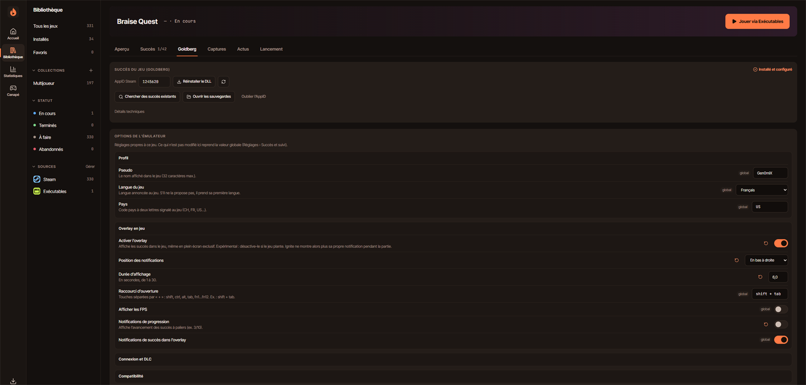

<p align="center">
  
</p>

<h1 align="center">Ignite</h1>

<p align="center">
  <strong>All your PC games in one place.</strong><br>
  Steam, GOG, Epic, Battle.net, EA, Ubisoft, Riot, executables and emulators<br>
  in a single library, with your playtime, achievements and stats.
</p>

<p align="center">
  <a href="https://github.com/Gen0miX/ignite/releases/latest"></a>
  <a href="https://github.com/Gen0miX/ignite/actions/workflows/ci.yml"></a>
  
  <a href="LICENSE"></a>
</p>

<p align="center">
  <a href="https://github.com/Gen0miX/ignite/releases/latest"><strong>Download Ignite</strong></a>
  · <a href="#features">Features</a>
  · <a href="#how-it-works">How it works</a>
  · <a href="#faq">FAQ</a>
  · <a href="README.md">Français</a>
</p>

> [!NOTE]
> The interface is available in **English and French**: Ignite follows your Windows language, and you can switch in **Settings › General**. The screenshots below show the French interface.



---

## Why Ignite?

Your games are spread across five launchers, folders of executables and emulators. Ignite brings them together without changing those launchers: it **reads** their libraries, **launches** games through the right client, **times** your sessions and gathers your **achievements** and **stats** in one place.

- **No account, no server, no telemetry.** Everything stays on your PC.
- **Read-only** on other launchers: Ignite never modifies their files.
- **Every source is optional**: a missing launcher is simply skipped.

## Features

### One library



- Automatic detection: **Steam**, **GOG Galaxy**, **Epic Games**, **Battle.net**, **EA app**, **Ubisoft Connect**, **Riot**.
- **Executables** (`.exe`, shortcuts, launcher links) and **folder scan**.
- **Emulators** with their ROM folders, and **RetroAchievements**.
- A game owned on two platforms shows up once, and you pick the client that launches it.
- Covers, heroes and logos (Steam, SteamGridDB), genres and player modes, filters, sorting, adjustable cover size.
- **Advanced search** (`source:gog genre:rpg heures:>20 joue:<30j`…) and **smart collections** that update themselves.

### Game page



- Playtime across all sources, session log, personal goals, resume note ("where did you stop?").
- Time to beat (IGDB), with manual correction.
- Trailer, screenshots and description (Steam or IGDB), game news.
- **Captures** tab: your Steam, Xbox Game Bar and custom-folder screenshots, with a viewer.

### Achievements



- **Steam**, **GOG**, **RetroAchievements**, and **executable** games through the Goldberg emulator (see below).
- Rarity: share of players, ultra-rares, "your rarest", progress over time.
- Ignite-styled notifications when an achievement unlocks, with its icon and rarity:

  

### Statistics



Playtime per period and per source, play calendar, most played games, streaks, backlog status.

### And also

- **Home**: resume your last game, "Tonight I have…" (suggestions based on the time you have), your backlog.
- **End-of-session recap**: duration, unlocked achievements, rating and status.
- **Couch mode**: full-screen, gamepad-friendly interface.
- **Notification area**: the current game and its timer; Ignite can start with Windows and stay in the background.
- **Automatic updates** from GitHub releases.

## Installation

1. Download **`Ignite_x.y.z_x64-setup.exe`** from the [latest release](https://github.com/Gen0miX/ignite/releases/latest).
2. Run it. It installs for your Windows account only, no administrator rights needed.
3. Open Ignite: your library fills itself with the launchers it finds.

> [!NOTE]
> The installer is not signed with a paid certificate, so Windows SmartScreen may say "Windows protected your PC". Click **More info**, then **Run anyway**. The code is open and every release is built by [GitHub Actions](.github/workflows/release.yml) from this repository.

**Requirements**: Windows 10 or 11, 64-bit. WebView2 ships with Windows 11; on Windows 10 the installer downloads it if needed.

**Updates**: when a new version is out, Ignite offers it at startup ("Install and restart"). You can also check in **Settings › About**.

## Getting started

Nothing is required: Ignite works from the first launch. These settings unlock extra features (**Settings › Accounts and keys**):

| Service | What it adds | How to get it |
|---|---|---|
| **Steam Web API key** | Owned but not installed Steam games, Steam achievements, Goldberg achievement definitions | Free at [steamcommunity.com/dev/apikey](https://steamcommunity.com/dev/apikey) |
| **SteamGridDB** | Covers, heroes and logos for non-Steam games | Free in your [steamgriddb.com](https://www.steamgriddb.com/) account preferences |
| **IGDB (Twitch)** | Time to beat, trailers and descriptions for games missing from Steam | A "Confidential" Twitch app at [dev.twitch.tv](https://dev.twitch.tv/console/apps) |
| **RetroAchievements** | Achievements for emulated games | Your username and Web API key on [retroachievements.org](https://retroachievements.org/) |

Keys are stored in the **Windows Credential Manager**. They never go to the database, logs or the interface.

## How it works

### Sources

Ignite reads what launchers already store on your PC: Steam manifests, the GOG Galaxy database (on a copy), Epic files, and Windows' installed programs list for Battle.net, EA, Ubisoft and Riot. It never modifies those files. To launch a game, it goes through its launcher (`steam://`, Galaxy, Epic…) or runs the executable directly.

### Playtime tracking

- Ignite spots the game's process every 3 seconds and times the session.
- Keyboard, mouse and gamepad are used to detect idle time: past the chosen threshold, the pause is removed from the session.
- Sessions that are too short (crash, launched by mistake) are ignored.
- Playtime already known by launchers (Steam, GOG…) is imported without ever counting the same period twice.

Thresholds are in **Settings › Achievements and tracking**.

### Achievements for executable games (Goldberg)

For a Steam game you run outside Steam (offline copy, DRM-free version of a game you own…), Ignite can install **[Goldberg / gbe_fork](https://github.com/Detanup01/gbe_fork)**, a Steam API emulator, to track its achievements.



- **Goldberg** tab on the game page: Ignite finds the `steam_api64.dll` the game actually loads (Unity, Unreal…), replaces it with Goldberg and **keeps the original** (`.ignite-original`).
- Achievement definitions and icons are generated from Steam (Web API key needed), and rarity percentages come from Steam's public stats.
- Emulator options can be edited in Ignite, as defaults for every game or per game: name, language, in-game overlay, offline mode, DLCs…
- Goldberg's **in-game overlay** (Shift+Tab) shows achievements even in exclusive fullscreen. It is experimental and may crash some games.

> [!IMPORTANT]
> Goldberg replaces a game file. Only use it with games you legitimately own, and knowingly. Ignite does not bypass any DRM.

### Your data

| What | Where |
|---|---|
| Library, sessions, notes, collections | `%APPDATA%\com.ignite.app\ignite.db` (SQLite) |
| Cached images | `%APPDATA%\com.ignite.app\artwork\` |
| API keys | Windows Credential Manager |
| Display preferences | WebView data (`%LOCALAPPDATA%\com.ignite.app\`) |

Ignite only connects to services useful for your games: Steam (store, API, images), SteamGridDB, IGDB, RetroAchievements, YouTube (trailers, no cookies) and GitHub (Ignite updates, Goldberg download). No personal data is sent anywhere else, and there is no telemetry.

## FAQ

**Does Ignite replace Steam or the other launchers?**
No. It relies on them: they must stay installed to launch their games, handle updates and cloud saves.

**A launcher is not detected.**
Check **Settings › Sources**: each source shows its status and its last error. You can also add a game by hand ("Add a game") or scan a folder.

**I play on two PCs.**
For now each PC has its own database. Syncing between PCs is planned.

## Development

Stack: [Tauri 2](https://tauri.app/) (Rust) + React 19, TypeScript and Vite, SQLite (`rusqlite`), TanStack Query, Zustand, CSS Modules.

```bash
pnpm install
pnpm tauri dev          # run the app in development
pnpm test               # frontend tests (Vitest)
pnpm test:rust          # Rust tests
pnpm lint && pnpm typecheck
```

Before contributing, read [`CLAUDE.md`](CLAUDE.md) (project rules) and the docs in [`docs/`](docs/) (in French): specification, architecture, per-source integrations, design. To publish a version, see [`docs/RELEASING.md`](docs/RELEASING.md).

Bugs and ideas: [open an issue](https://github.com/Gen0miX/ignite/issues/new/choose).

## Credits

- [Tauri](https://tauri.app/), [React](https://react.dev/), [Lucide](https://lucide.dev/) (icons), [Simple Icons](https://simpleicons.org/) (platform logos), [Inter Tight](https://fonts.google.com/specimen/Inter+Tight) and [JetBrains Mono](https://www.jetbrains.com/lp/mono/) fonts.
- [gbe_fork](https://github.com/Detanup01/gbe_fork) (Goldberg Steam Emulator), [SteamGridDB](https://www.steamgriddb.com/), [IGDB](https://www.igdb.com/), [RetroAchievements](https://retroachievements.org/).

Ignite is not affiliated with Valve, GOG, Epic Games, Microsoft, Blizzard, Electronic Arts, Ubisoft or Riot Games. Game names and images belong to their respective owners.

## License

[MIT](LICENSE) © Gen0miX
