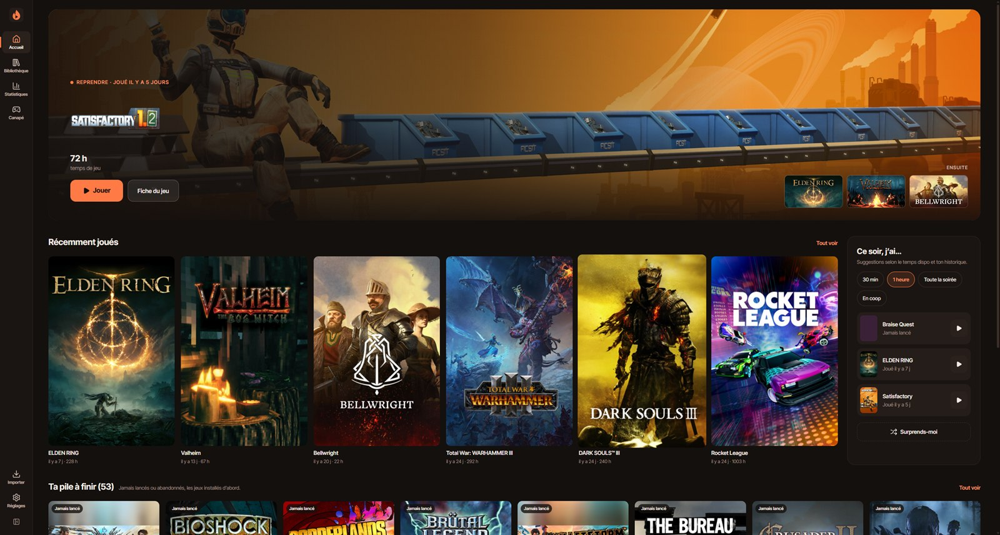
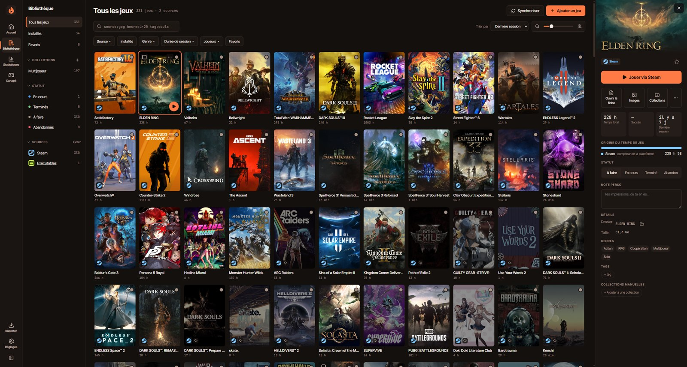
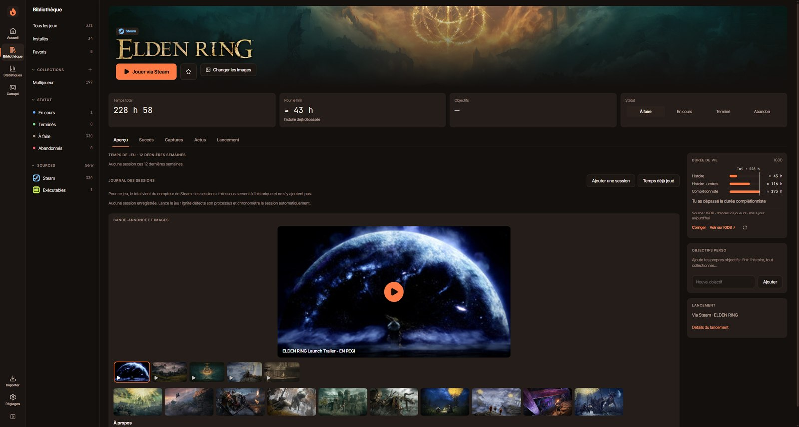
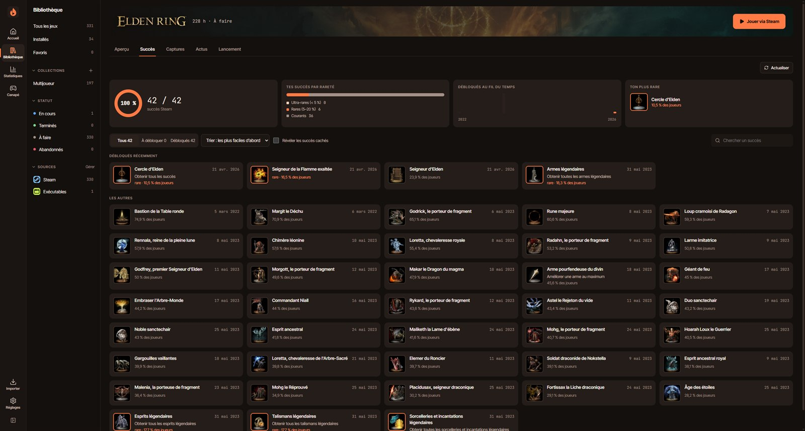
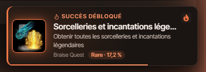
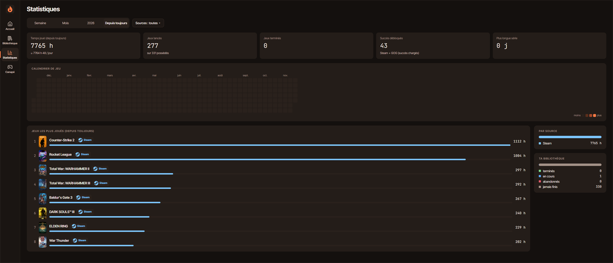
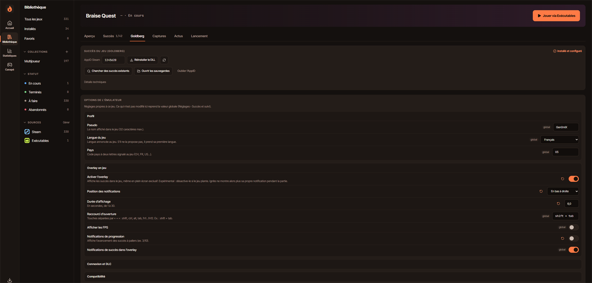

<p align="center">
  
</p>

<h1 align="center">Ignite</h1>

<p align="center">
  <strong>Tous tes jeux PC au même endroit.</strong><br>
  Steam, GOG, Epic, Battle.net, EA, Ubisoft, Riot, exécutables et émulateurs<br>
  dans une seule bibliothèque, avec ton temps de jeu, tes succès et tes stats.
</p>

<p align="center">
  <a href="https://github.com/Gen0miX/ignite/releases/latest"></a>
  <a href="https://github.com/Gen0miX/ignite/actions/workflows/ci.yml"></a>
  
  <a href="LICENSE"></a>
</p>

<p align="center">
  <a href="https://github.com/Gen0miX/ignite/releases/latest"><strong>Télécharger Ignite</strong></a>
  · <a href="#fonctionnalités">Fonctionnalités</a>
  · <a href="#comment-ça-marche">Comment ça marche</a>
  · <a href="#faq">FAQ</a>
  · <a href="README.en.md">English</a>
</p>



---

## Pourquoi Ignite ?

Tes jeux sont éparpillés entre cinq launchers, des dossiers d'exécutables et des émulateurs. Ignite les rassemble sans rien changer à ces launchers : il **lit** leurs bibliothèques, **lance** les jeux par le bon client, **chronomètre** tes sessions et réunit tes **succès** et **statistiques** au même endroit.

- **Pas de compte, pas de serveur, pas de télémétrie.** Tout reste sur ton PC.
- **Lecture seule** sur les autres launchers : Ignite ne modifie jamais leurs fichiers.
- **Chaque source est facultative** : un launcher absent est simplement ignoré.

## Fonctionnalités

### Une seule bibliothèque



- Détection automatique : **Steam**, **GOG Galaxy**, **Epic Games**, **Battle.net**, **EA app**, **Ubisoft Connect**, **Riot**.
- **Exécutables** (`.exe`, raccourcis, liens de launcher) et **scan de dossiers** (« Scanner ce PC »).
- **Émulateurs** avec leurs dossiers de ROM, et succès **RetroAchievements**.
- Un jeu possédé sur deux plateformes n'apparaît qu'une fois, avec le choix du client pour le lancer.
- Jaquettes, fonds et logos (Steam, SteamGridDB), genres et modes de jeu, filtres, tri, taille des jaquettes réglable.
- **Recherche avancée** (`source:gog genre:rpg heures:>20 joue:<30j`…) et **collections intelligentes** qui se mettent à jour seules.

### Fiche de jeu



- Temps de jeu toutes sources confondues, journal des sessions, objectifs perso, note de reprise (« où t'es-tu arrêté ? »).
- Durée pour finir (IGDB), avec correction manuelle.
- Bande-annonce, captures et description (Steam ou IGDB), actus du jeu.
- Onglet **Captures** : tes captures Steam, Xbox Game Bar et dossiers perso, avec visionneuse.

### Succès



- **Steam**, **GOG**, **RetroAchievements**, et les jeux **exécutables** via l'émulateur Goldberg (voir plus bas).
- Rareté : pourcentage de joueurs, ultra-rares, « ton plus rare », progression au fil du temps.
- Notifications aux couleurs d'Ignite quand un succès se débloque, avec son icône et sa rareté :

  

### Statistiques



Temps joué par période et par source, calendrier de jeu, jeux les plus joués, séries, état de ta pile.

### Et aussi

- **Accueil** : reprendre le dernier jeu, « Ce soir, j'ai… » (suggestions selon ton temps dispo), ta pile à finir.
- **Récap de fin de session** : durée, succès débloqués, note et statut.
- **Mode Canapé** : interface plein écran pilotable à la manette.
- **Zone de notification** : le jeu en cours et son chrono ; Ignite peut démarrer avec Windows et rester en arrière-plan.
- **Mises à jour automatiques** depuis les releases GitHub.

## Installation

1. Télécharge **`Ignite_x.y.z_x64-setup.exe`** depuis la [dernière release](https://github.com/Gen0miX/ignite/releases/latest).
2. Lance-le. L'installation se fait pour ton compte Windows seulement, sans droits administrateur.
3. Ouvre Ignite : ta bibliothèque se remplit toute seule avec les launchers détectés.

> [!NOTE]
> L'installeur n'est pas signé avec un certificat payant : Windows SmartScreen peut afficher « Windows a protégé votre ordinateur ». Clique sur **Informations complémentaires**, puis **Exécuter quand même**. Le code est ouvert et chaque release est construite par [GitHub Actions](.github/workflows/release.yml) à partir de ce dépôt.

**Configuration requise** : Windows 10 ou 11, 64 bits. WebView2 est déjà présent sur Windows 11 ; sur Windows 10, l'installeur le télécharge si besoin.

**Mises à jour** : quand une nouvelle version sort, Ignite la propose au démarrage (« Installer et redémarrer »). Tu peux aussi vérifier dans **Réglages › À propos**.

## Premiers pas

Rien n'est obligatoire : Ignite fonctionne dès le premier lancement. Ces réglages débloquent des fonctions en plus (**Réglages › Comptes et clés**) :

| Service | Ce que ça apporte | Comment l'obtenir |
|---|---|---|
| **Clé Steam Web API** | Jeux Steam possédés mais pas installés, succès Steam, définitions des succès Goldberg | Gratuite sur [steamcommunity.com/dev/apikey](https://steamcommunity.com/dev/apikey) |
| **SteamGridDB** | Jaquettes, fonds et logos pour les jeux hors Steam | Gratuite dans les préférences de ton compte [steamgriddb.com](https://www.steamgriddb.com/) |
| **IGDB (Twitch)** | Durées pour finir, bandes-annonces et descriptions des jeux absents de Steam | Application Twitch « Confidentielle » sur [dev.twitch.tv](https://dev.twitch.tv/console/apps) |
| **RetroAchievements** | Succès des jeux d'émulateur | Ton pseudo et ta clé Web API sur [retroachievements.org](https://retroachievements.org/) |

Les clés sont rangées dans le **Gestionnaire d'identification Windows**. Elles ne vont jamais dans la base de données, les logs ou l'interface.

## Comment ça marche

### Sources

Ignite lit ce que les launchers enregistrent déjà sur ton PC : manifestes Steam, base de GOG Galaxy (sur une copie), fichiers d'Epic, liste des programmes installés de Windows pour Battle.net, EA, Ubisoft et Riot. Il ne modifie jamais ces fichiers. Pour lancer un jeu, il passe par son launcher (`steam://`, Galaxy, Epic…) ou lance directement l'exécutable.

### Suivi du temps

- Ignite repère le processus du jeu toutes les 3 secondes et chronomètre la session.
- Clavier, souris et manette servent à détecter l'inactivité : au-delà du seuil choisi, la pause est retirée de la session.
- Les sessions trop courtes (crash, lancement par erreur) sont ignorées.
- Le temps déjà connu des launchers (Steam, GOG…) est importé sans jamais compter deux fois la même période.

Les seuils se règlent dans **Réglages › Succès et suivi**.

### Succès des jeux exécutables (Goldberg)

Pour un jeu Steam que tu lances en dehors de Steam (copie hors ligne, version sans DRM d'un jeu que tu possèdes…), Ignite peut installer **[Goldberg / gbe_fork](https://github.com/Detanup01/gbe_fork)**, un émulateur de l'API Steam, pour en suivre les succès.



- Onglet **Goldberg** de la fiche du jeu : Ignite repère le `steam_api64.dll` que le jeu charge vraiment (Unity, Unreal…), le remplace par Goldberg et **garde l'original** (`.ignite-original`).
- Les définitions et icônes des succès sont générées depuis Steam (clé Web API nécessaire), et les pourcentages de rareté viennent des statistiques publiques Steam.
- Options de l'émulateur modifiables dans Ignite, par défaut pour tous les jeux (**Réglages › Succès et suivi**) ou jeu par jeu : pseudo, langue, overlay en jeu, mode hors ligne, DLC…
- L'**overlay en jeu** de Goldberg (Maj+Tab) affiche les succès même en plein écran exclusif. Il est expérimental et peut faire planter certains jeux.

> [!IMPORTANT]
> Goldberg remplace un fichier du jeu. Utilise-le uniquement pour des jeux que tu possèdes légitimement, et en connaissance de cause. Ignite ne contourne aucun DRM.

### Tes données

| Quoi | Où |
|---|---|
| Bibliothèque, sessions, notes, collections | `%APPDATA%\com.ignite.app\ignite.db` (SQLite) |
| Images en cache | `%APPDATA%\com.ignite.app\artwork\` |
| Clés d'API | Gestionnaire d'identification Windows |
| Préférences d'affichage | Données du WebView (`%LOCALAPPDATA%\com.ignite.app\`) |

Ignite ne se connecte qu'aux services utiles à tes jeux : Steam (store, API, images), SteamGridDB, IGDB, RetroAchievements, YouTube (bandes-annonces, sans cookies), et GitHub (mises à jour d'Ignite, téléchargement de Goldberg). Aucune donnée personnelle n'est envoyée ailleurs, et il n'y a pas de télémétrie.

## FAQ

**Ignite remplace-t-il Steam ou les autres launchers ?**
Non. Il s'appuie sur eux : ils doivent rester installés pour lancer leurs jeux, gérer les mises à jour et les sauvegardes cloud.

**Un launcher n'est pas détecté.**
Regarde **Réglages › Sources** : chaque source y affiche son état et son dernier message d'erreur. Tu peux aussi ajouter un jeu à la main (« Ajouter un jeu ») ou scanner un dossier.

**Mon temps de jeu Steam ne bouge pas.**
Ignite importe le temps enregistré par Steam et chronomètre lui-même les sessions lancées pendant qu'il tourne. Garde Ignite ouvert (ou dans la zone de notification) pendant que tu joues.

**Je joue sur deux PC.**
Pour l'instant, chaque PC a sa propre base. La synchronisation entre PC est prévue.

**L'app est-elle traduite ?**
Seulement en français pour l'instant. La traduction de l'interface est prévue.

## Développement

Stack : [Tauri 2](https://tauri.app/) (Rust) + React 19, TypeScript et Vite, SQLite (`rusqlite`), TanStack Query, Zustand, CSS Modules.

```bash
pnpm install
pnpm tauri dev          # lancer l'app en développement
pnpm test               # tests frontend (Vitest)
pnpm test:rust          # tests Rust
pnpm lint && pnpm typecheck
```

Avant de contribuer, lis [`CLAUDE.md`](CLAUDE.md) (règles du projet) et la doc de [`docs/`](docs/) : spécification, architecture, intégrations par source, design. Pour publier une version, voir [`docs/RELEASING.md`](docs/RELEASING.md).

Bugs et idées : [ouvre un ticket](https://github.com/Gen0miX/ignite/issues/new/choose).

## Crédits

- [Tauri](https://tauri.app/), [React](https://react.dev/), [Lucide](https://lucide.dev/) (icônes), [Simple Icons](https://simpleicons.org/) (logos des plateformes), polices [Inter Tight](https://fonts.google.com/specimen/Inter+Tight) et [JetBrains Mono](https://www.jetbrains.com/lp/mono/).
- [gbe_fork](https://github.com/Detanup01/gbe_fork) (Goldberg Steam Emulator), [SteamGridDB](https://www.steamgriddb.com/), [IGDB](https://www.igdb.com/), [RetroAchievements](https://retroachievements.org/).

Ignite n'est affilié ni à Valve, ni à GOG, Epic Games, Microsoft, Blizzard, Electronic Arts, Ubisoft ou Riot Games. Les noms et images des jeux appartiennent à leurs ayants droit.

## Licence

[MIT](LICENSE) © Gen0miX
